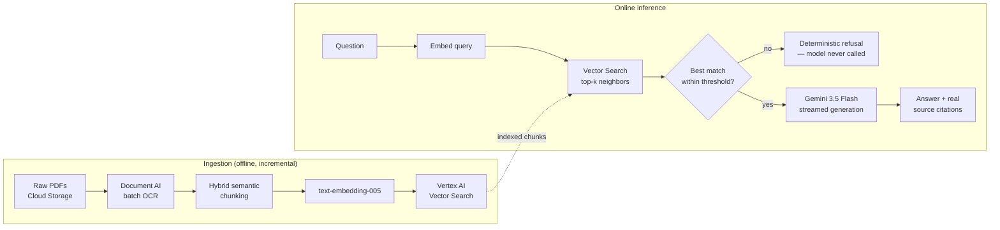

# RAG Cardiology Assistant

A retrieval-augmented Q&A assistant for cardiology research papers — built as a portfolio project to practice real production RAG engineering, not a tutorial walkthrough. Every answer is grounded in retrieved excerpts from an indexed corpus of real clinical papers and guidelines, with the exact source paragraph returned alongside the answer.

**Live demo:** see `demo.gif` below (the hosted endpoint is undeployed after recording to avoid ongoing GCP cost — architecture and code are fully real, this repo is a working reference, not a toy).

## Why this exists

Doctors asking a clinical question need an answer they can trust, which means two things a generic chatbot doesn't give you: the answer has to come *only* from real sources, and it has to say exactly which source. This project is an exercise in building that constraint into the system at the architecture level rather than hoping the prompt holds:

- Retrieval returns the ground-truth chunks; the model is never allowed to self-report what it "used."
- A distance-threshold gate refuses to answer in code, before the model is even called, if nothing in the corpus is actually close enough to the question — not left to the model's judgment.
- Every citation shown to the user is the real chunk that was retrieved and fed to the model, with the real paper title, journal, and a verified DOI link.

## Architecture



**Backend:** FastAPI on Cloud Run, streams the answer token-by-token via a `text/plain` chunked response (a `⁣⁣SOURCES⁣⁣` delimiter separates the streamed answer from a trailing JSON block of source citations).

**Frontend:** React (Vite), reads the stream with the Fetch API's `ReadableStream`, and paces the reveal client-side with a timed typewriter effect — decoupled from however fast the network actually delivers chunks, so the UI reads consistently regardless of connection speed.

**CI/CD:** GitHub → Cloud Build (2nd-gen repo connection) → Cloud Run. A push to `main` is the only deploy step; `cloudbuild.yaml` builds the image, pushes it, and runs `gcloud run deploy`.

## Engineering decisions worth knowing about

**Deterministic refusal, not prompted refusal.** The system prompt instructs the model to refuse when it lacks information, but that's a backstop, not the mechanism — the real gate is in code: if the closest retrieved chunk is further than `DISTANCE_THRESHOLD` (0.35), the model is never called at all. Validated empirically: in-scope questions scored 0.14–0.22 distance; an out-of-scope control question (asking about Lupus, which the corpus doesn't cover) scored 0.46 — a clean separation with no overlap.

**SDK migration, not just a model swap.** Generation originally used the `vertexai.generative_models` SDK. Migrating to `gemini-3.5-flash` ahead of `gemini-2.5-flash`'s deprecation surfaced a subtler problem: that SDK's `vertexai.init(location="global")` call shares global state with the separate Vector Search client, and silently broke retrieval. Fixed by moving generation onto the newer, independent `google-genai` SDK (`genai.Client(...)`), which doesn't share state with `aiplatform.MatchingEngineIndexEndpoint`.

**Fine-tuning evaluated, then deferred in favor of few-shot prompting.** A 100-question clinical eval set was available, but only ~5-6 questions genuinely overlapped with this corpus's 7 source papers — under Vertex AI's hard minimum of 16 training examples for supervised tuning (recommended 100-500). Training on the rest would have taught the model to confidently answer from facts its own retrieval could never surface — exactly the failure mode the refusal gate exists to prevent. Shipped a single real, fully-grounded worked example in the system prompt instead: zero added cost, fully reversible, same style benefit for the data actually available.

**Cost-aware index configuration.** Vertex AI Vector Search defaults to `SHARD_SIZE_MEDIUM`, which only runs on `e2-standard-16` (~$0.62/hr). Explicitly set `shard_size="SHARD_SIZE_SMALL"` to run on `e2-standard-2` (~$0.09/hr) instead — same index type (Tree-AH), correctly sized for a 7-paper corpus.

## Retrieval validation

7 real test questions against the deployed index — one per source paper, plus an out-of-scope control:

| Test question | Correct source | Top distance | Result |
|---|---|---:|---|
| Myocardial viability → survival benefit from CABG? | `Myocardial_Viability` | 0.1645 | Pass |
| ECG monitoring duration after ischemic stroke? | `Cryptogenic_Stroke` | 0.2034 | Pass |
| Acute chest pain evaluation in the ED? | `Acute_Chest_Pain_Emergency_Department` | 0.1957 | Pass |
| Current guidelines for diagnosing chest pain? | `Guideline_Evaluation_and_Diagnosis_Chest_Pain` | 0.1438 | Pass |
| Type 2 diabetes & cardiovascular mortality? | `Cardiovascular_Outcomes_Mortality_Type2_Diabetes` | 0.2211 | Pass |
| Sodium bicarbonate preventing contrast-induced AKI? | `Outcomes_after_Angiography` | 0.1537 | Pass |
| Latest treatment guidelines for Lupus? *(control, not in corpus)* | — none, correctly | 0.4573 | Control |

6/6 in-scope questions retrieved from the correct paper. The control question's best distance was 2-3× every in-scope match, with no overlap — the system doesn't force a confident-looking answer when the corpus genuinely has nothing relevant.

## Corpus

7 cardiology papers and guidelines (chest pain evaluation, SGLT2i cardiovascular outcomes, cryptogenic stroke/AF detection, sudden cardiac death prevention, myocardial viability, contrast-induced nephropathy prevention), indexed incrementally — new papers can be added without reprocessing the existing corpus (see `reindex_new_studies.py`).

## Project structure

```
src/
  create_processor.py       One-time setup: Document AI OCR processor
  extract_text.py           Step 2a: batch OCR extraction from raw PDFs
  chunk_text.py             Step 2b: hybrid semantic chunking
  build_embeddings.py       Step 3: embed chunks, prep Vector Search input files
  create_index.py           Step 4: create the Vector Search index (Tree-AH)
  deploy_index.py           Step 5: deploy the index to a queryable endpoint
  query_index.py            Step 6: validate retrieval against real test questions
  reindex_new_studies.py    Phase 2: incremental re-indexing for newly added papers
  generate_answer.py        Phase 3: retrieval + generation + streaming + citations
  app.py                    Phase 4: FastAPI backend wrapping generate_answer.py
  validate_embeddings.py    Diagnostic: structural checks on embeddings before indexing
  check_citations.py        Diagnostic: pulls verified title/journal text from indexed chunks

frontend/
  src/App.jsx                React chat UI — streaming answers, citation cards
  src/App.css                Styling

cloudbuild.yaml              CI/CD: build → push → deploy on push to main
Dockerfile                   Backend container (FastAPI + uvicorn)
```

## Running it locally

Requires a GCP project with Document AI, Vertex AI, and Vector Search enabled, and `gcloud auth application-default login` configured.

```bash
python3 -m venv venv && source venv/bin/activate
pip install -r requirements.txt

# Backend (from src/)
cd src && uvicorn app:app --reload --port 8080

# Frontend (separate terminal, from frontend/)
cd frontend && npm install && npm run dev
```

Set `BACKEND_URL` in `frontend/src/App.jsx` to point at your running backend.

To build the index from scratch against your own corpus, run the `src/` pipeline scripts in the numbered order shown above — each is a standalone step, so you can rerun one without redoing the others. Document AI OCR and embedding calls are billed; test against a small PDF before running the full corpus.

## What's next

- **Evaluation framework** — formal retrieval precision/recall@K and LLM-as-judge groundedness scoring, beyond the manual validation above.
- **Monitoring** — latency/error tracking on the Cloud Run backend and the Vector Search endpoint.
- **Supervised fine-tuning** — revisit once there's a properly-sized (16+, ideally 100+) in-domain Q&A dataset for this corpus specifically.

## Stack

Document AI · Vertex AI Vector Search · Vertex AI Embeddings (`text-embedding-005`) · Gemini 3.5 Flash (`google-genai` SDK) · FastAPI · Cloud Run · Cloud Build · React (Vite)
